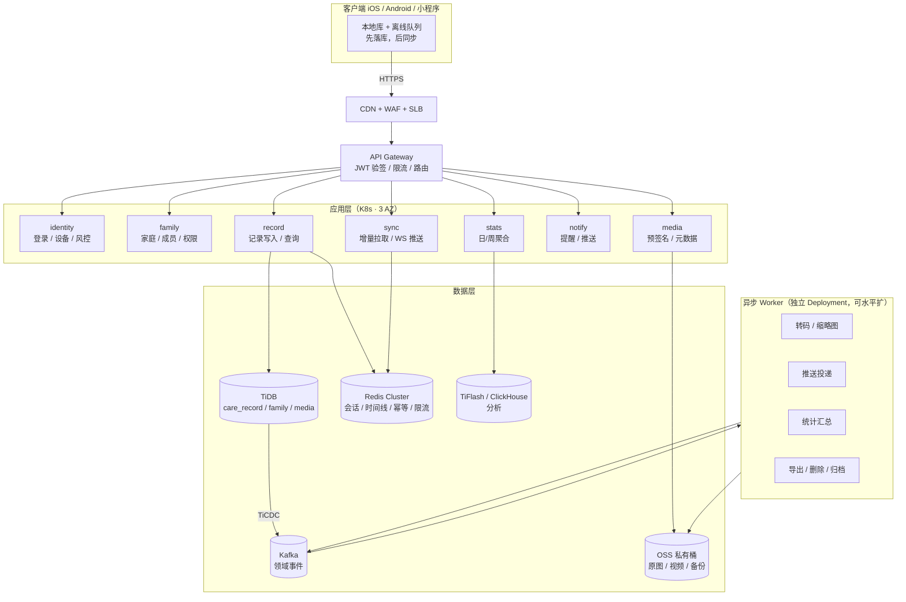
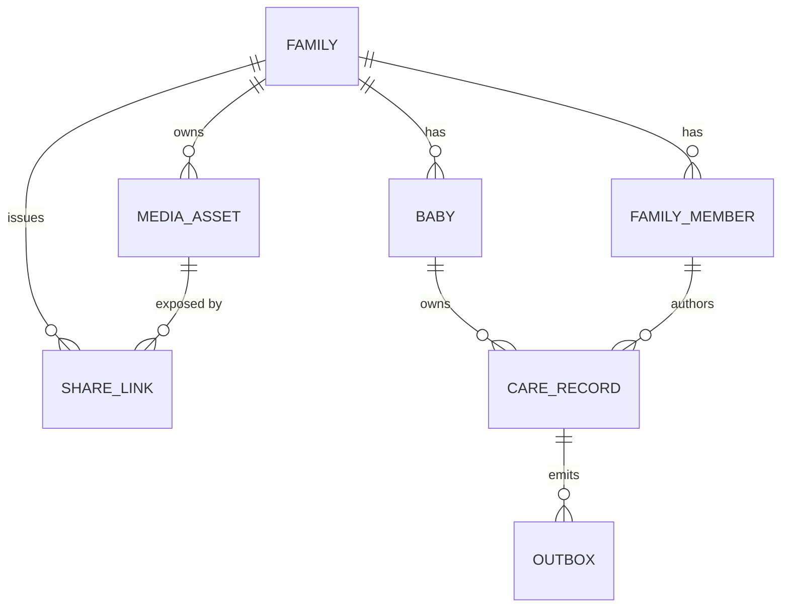
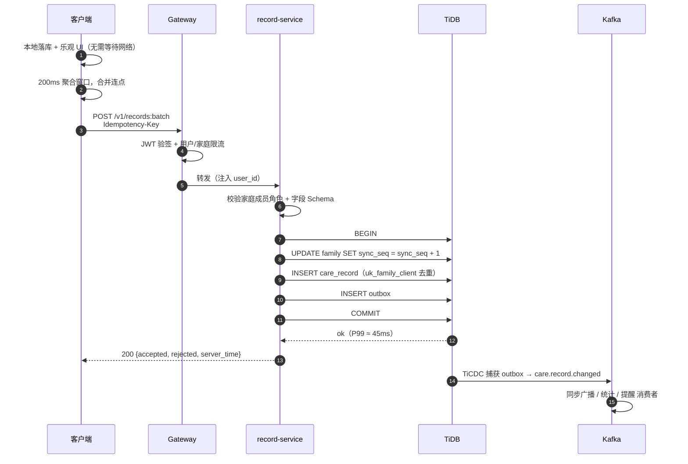
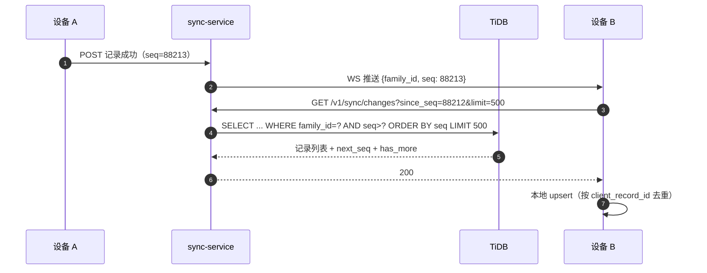
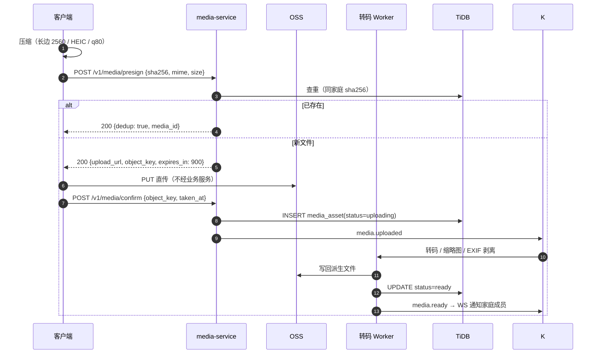

# Nestory 后端架构设计说明书 v1.0

| 项 | 内容 |
| --- | --- |
| 版本 | v1.0（评审稿） |
| 日期 | 2026-11-12 |
| 范围 | Nestory App 后端：记录、家庭协作、相册、提醒、统计、同步 |
| 前提 | 6 人后端团队，3 个月出 MVP，中国大陆合规（PIPL / 儿童个人信息规定 / 等保三级） |
| 关联 | 前端数据模型 `src/data/types.ts`；产品 PRD |

---

## 0. 一页结论（TL;DR）

**三个关键决策**

1. **架构形态：模块化单体，不是微服务。**
   按领域分包（identity / family / record / sync / media / notify / stats），进程内调用；只有媒体转码、推送投递、统计汇总这三类「重活、可异步、可重试」的能力拆成独立 Worker。6 个人维护 7 个服务已经是上限，再多就是给自己挖坑。
2. **主存储：TiDB（MySQL 协议），`family_id` 作分片键。**
   所有记录类型收敛到一张 `care_record` 表，靠「每家庭单调递增的 `sync_seq`」做增量同步和冲突判定。理由见 §7.1——单机 PG 在 12 个月内会到 40 亿行，备份窗口和在线 DDL 都会失控。
3. **写路径短、同步、幂等；一切扇出异步。**
   接口只做「鉴权 → 校验 → 一个事务写记录 + outbox → 返回」，P99 目标 120ms；推送、统计、实时同步、Webhook 全部走 CDC → Kafka 异步消费。夜间峰值时**宁可延迟推送和报表，也不丢一条记录**。

**一组关键数字**

| 指标 | 值 |
| --- | --- |
| 日均记录写入 | 1,080 万条 |
| 夜间（0–6 点）平均写 | 200 写/s |
| 夜间峰值写 | ≈ 800 写/s（设计目标 5,000/s，6× 余量） |
| 峰值读 + 同步 QPS | ≈ 2,500 |
| 夜间长连接 | ≈ 11 万（设计 20 万） |
| 记录存储 3 年 | 4.7 TB（单副本）/ 14 TB（3 副本） |
| 媒体存储 3 年 | ≈ 100 TB |
| 写 P99 | ≤ 120 ms |
| 可用性 | 99.95%（月停机 ≤ 21.6 min） |
| MVP 月成本 | ≈ ¥2.8 万 |

**架构全景**



---

## 1. 需求与范围

### 1.1 功能需求

| 模块 | 关键能力 | 后端要点 |
| --- | --- | --- |
| 身份 | 手机号验证码登录、微信/Apple 登录、设备管理 | 短 JWT + 刷新轮换、设备绑定、登录风控 |
| 家庭 | 创建家庭、邀请成员、角色（admin / edit / read）、转让 | 邀请链接一次性 token、权限矩阵、成员变更实时生效 |
| 宝宝档案 | 姓名、生日、出生信息、头像、多宝宝（双胞胎） | `family 1:N baby`，头像走媒体流程 |
| 记录 | 喂养（亲喂左右时长 / 瓶喂 ml）、睡眠、尿布、成长、里程碑 | 统一记录表 + 幂等写 + 离线补录 + 软删 |
| 相册 | 照片 / Live Photo / 视频、上传、浏览、分享 | 直传 OSS、转码、私有读、签名 URL、EXIF 剥离 |
| 提醒 | 喂养间隔提醒、夜间免打扰、振动 | 服务端只算「到点」并下发，不依赖长连接存活 |
| 统计 | 日 / 周趋势、24 小时分布、WHO 百分位 | 预聚合表 + TiFlash，禁止实时扫明细表 |
| 同步 | 多端增量同步、离线补传、冲突处理 | `sync_seq` 游标 + WS 唤醒 + 全量兜底 |

### 1.2 非功能需求（SLO）

| 指标 | 目标 | 验证方式 |
| --- | --- | --- |
| 写入成功率 | ≥ 99.95% / 月 | 网关 2xx 比例 |
| 写 P99 | ≤ 120 ms（同城） | APM 直方图 |
| 读 P99 | ≤ 200 ms | APM |
| 同步延迟 | P95 ≤ 3 s（写入 → 其他设备可见） | 端到端埋点 |
| 推送到达 | P95 ≤ 5 s | 厂商回执 |
| 可用性 | 99.95%（21.6 min / 月） | 多探测点 |
| 数据可靠性 | RPO = 0（同城），异地 ≤ 5 min | 故障演练 |
| 恢复时间 | 单节点 RTO < 30 s；AZ 级 < 5 min | 混沌演练 |

### 1.3 明确不做（MVP 范围外）

社区动态 / 关注 feed、广告与商品推荐、AI 育儿建议、硬件（温奶器 / 监护仪）直连、月嫂撮合交易、跨家庭共享相册、家长端 Web 后台。

> 这些能力的接口和数据模型预留扩展位（如 `care_record.payload` 的 JSONB 字段、`outbox` 事件），但**不实现**。

---

## 2. 容量估算

### 2.1 记录写入

```
日写入量 = DAU × 人均记录数 = 600,000 × 18 = 10,800,000 条/日
平均写 QPS = 10,800,000 / 86,400 ≈ 125/s
夜间写入量 = 10,800,000 × 40% = 4,320,000 条 / 21,600s = 200/s
夜间峰值 = 200 × 4（峰值系数）= 800/s
家庭并发修正（2.5 台设备同时操作）= 800 × 1.2 ≈ 960/s
```

**设计目标：峰值写 5,000 QPS**（≈ 6 倍余量），覆盖运营活动、开学季、版本发布后的集中回流。

写入放大：1 条记录 = 1 行数据 + 2 个二级索引 + 1 条 outbox ≈ 4 次写 → 峰值约 3,800 IOPS。

### 2.2 读取与长连接

| 项 | 估算 |
| --- | --- |
| 人均请求 | 8 次会话 × 3 接口 ≈ 24 次/日 |
| 平均读 QPS | 600,000 × 24 / 86,400 ≈ 167/s |
| 峰值读 QPS | 167 × 6 ≈ 1,000/s |
| 同步增量拉取 | 峰值 ≈ 800/s（每次写入触发 1 次拉取） |
| 长连接 | 夜间在线设备 ≈ DAU × 15% ≈ 9 万 × 1.2 ≈ 11 万，按 20 万设计 |

### 2.3 存储

```
单条记录 ≈ 400 B（列 100 + payload 150 + 索引 150）
日增 = 10,800,000 × 400 B ≈ 4.3 GB
年增 ≈ 1.6 TB；3 年 ≈ 4.7 TB（单副本）
TiKV 3 副本 ≈ 14 TB
```

### 2.4 媒体

```
活跃家庭 = 600,000 / 2.5 = 240,000
上传渗透率 = 30%（当日有上传的家庭）
照片：240,000 × 30% × 2 张 = 144,000 张/日 × 500 KB ≈ 72 GB
视频：240,000 × 30% × 0.15 条 = 10,800 条/日 × 3 MB ≈ 32 GB
合计 ≈ 104 GB/日 ≈ 38 TB/年（含缩略图 +10%）→ 3 年 ≈ 100 TB
CDN 出流：240,000 × 20 张 × 40 KB ≈ 192 GB/日 ≈ 5.7 TB/月
```

> **关键判断：绝对 QPS 并不高，真正难的是「突发比」和「不可丢」。**
> 夜间峰值 800 写/s，一个 3 节点 TiDB 轻松扛住；但如果按峰值配置资源，白天会闲置 80%。
> 所以本方案的重点不是「堆机器」，而是：① 客户端聚合 + 弹性伸缩削平突发；② 写路径足够短且幂等，任何环节失败都能重试而不产生重复；③ 存储与同步模型能线性扩展到 10 倍规模而不用重写。

### 2.5 压测目标

| 场景 | 目标 |
| --- | --- |
| 夜间突发写入 | 5,000 写/s 持续 10 min，P99 ≤ 120 ms，错误率 < 0.1% |
| 混合读写 | 5,000 写 + 8,000 读，P99 ≤ 200 ms |
| 长连接 | 20 万连接，广播延迟 P95 ≤ 3 s |
| 故障注入 | 杀掉 1 个 TiKV / 1 个 Redis 主 / 1 个 AZ，写入成功率 ≥ 99% |
| 离线补传 | 单设备积压 5,000 条，10 min 内追平且无重复 |

---

## 3. 领域模型与数据模型

### 3.1 限界上下文

| 上下文 | 职责 | 聚合根 |
| --- | --- | --- |
| Identity | 账号、登录、设备、风控 | User |
| Family | 家庭、成员、角色、邀请 | Family |
| Baby | 宝宝档案、头像 | Baby |
| Record | 五类记录的统一写入与查询 | CareRecord |
| Sync | 增量游标、实时推送、全量重建 | SyncCursor |
| Media | 上传、转码、访问授权、配额 | MediaAsset |
| Notify | 提醒计划、推送任务、免打扰 | Reminder |
| Stats | 日 / 周聚合、百分位 | DailyStat |

### 3.2 ER 图



### 3.3 核心 DDL（TiDB / MySQL 语法）

```sql
-- 家庭：sync_seq 是该家庭所有变更的单调游标
CREATE TABLE family (
  id          BIGINT UNSIGNED NOT NULL AUTO_INCREMENT,
  name        VARCHAR(64)     NOT NULL,
  sync_seq    BIGINT UNSIGNED NOT NULL DEFAULT 0,
  status      TINYINT         NOT NULL DEFAULT 1 COMMENT '1 active, 2 deleting',
  created_at  DATETIME(3)     NOT NULL DEFAULT CURRENT_TIMESTAMP(3),
  PRIMARY KEY (id)
);

CREATE TABLE family_member (
  id         BIGINT UNSIGNED NOT NULL AUTO_INCREMENT,
  family_id  BIGINT UNSIGNED NOT NULL,
  user_id    BIGINT UNSIGNED NOT NULL,
  role       TINYINT         NOT NULL COMMENT '1 admin, 2 edit, 3 read',
  relation   VARCHAR(16)     NULL COMMENT '妈妈/爸爸/祖辈/月嫂',
  status     TINYINT         NOT NULL DEFAULT 1,
  joined_at  DATETIME(3)     NULL,
  PRIMARY KEY (id),
  UNIQUE KEY uk_family_user (family_id, user_id),
  KEY idx_user (user_id)
);

-- 统一记录表：所有类型共用，payload 放类型私有字段
CREATE TABLE care_record (
  id               BIGINT UNSIGNED NOT NULL COMMENT 'Snowflake',
  family_id        BIGINT UNSIGNED NOT NULL,
  baby_id          BIGINT UNSIGNED NOT NULL,
  type             TINYINT         NOT NULL COMMENT '1 feed 2 sleep 3 diaper 4 growth 5 milestone',
  occurred_at      DATETIME(3)     NOT NULL COMMENT '业务时间，客户端本地时间换算 UTC',
  ended_at         DATETIME(3)     NULL,
  duration_sec     INT             NULL COMMENT '睡眠/亲喂时长，供聚合直接使用',
  amount_ml        INT             NULL COMMENT '瓶喂毫升，供聚合直接使用',
  kind             VARCHAR(16)     NULL COMMENT 'diaper: wet/dirty/both',
  payload          JSON            NULL COMMENT '类型私有字段',
  author_id        BIGINT UNSIGNED NOT NULL,
  device_id        VARCHAR(64)     NOT NULL,
  client_record_id CHAR(36)        NOT NULL COMMENT '客户端 UUIDv7，幂等键',
  seq              BIGINT UNSIGNED NOT NULL COMMENT '家庭内单调递增',
  version          INT             NOT NULL DEFAULT 1,
  deleted_at       DATETIME(3)     NULL COMMENT '软删，墓碑同步',
  created_at       DATETIME(3)     NOT NULL DEFAULT CURRENT_TIMESTAMP(3),
  updated_at       DATETIME(3)     NOT NULL DEFAULT CURRENT_TIMESTAMP(3) ON UPDATE CURRENT_TIMESTAMP(3),
  PRIMARY KEY (family_id, id),
  UNIQUE KEY uk_family_client (family_id, client_record_id),
  KEY idx_family_seq (family_id, seq),
  KEY idx_baby_time (baby_id, occurred_at)
);

CREATE TABLE media_asset (
  id          BIGINT UNSIGNED NOT NULL,
  family_id   BIGINT UNSIGNED NOT NULL,
  baby_id     BIGINT UNSIGNED NULL,
  object_key  VARCHAR(255)    NOT NULL COMMENT '不含任何 PII',
  mime        VARCHAR(64)     NOT NULL,
  size_bytes  BIGINT          NOT NULL,
  sha256      CHAR(64)        NOT NULL,
  width       INT NULL, height INT NULL, duration_ms INT NULL,
  kind        TINYINT         NOT NULL COMMENT '1 photo 2 live 3 video',
  status      TINYINT         NOT NULL DEFAULT 1 COMMENT '1 uploading 2 ready 3 failed 4 deleted',
  taken_at    DATETIME(3)     NULL,
  uploaded_by BIGINT UNSIGNED NOT NULL,
  seq         BIGINT UNSIGNED NOT NULL,
  created_at  DATETIME(3)     NOT NULL DEFAULT CURRENT_TIMESTAMP(3),
  PRIMARY KEY (family_id, id),
  UNIQUE KEY uk_family_sha (family_id, sha256)
);

CREATE TABLE outbox (
  id             BIGINT UNSIGNED NOT NULL AUTO_INCREMENT,
  aggregate_type VARCHAR(32)     NOT NULL,
  aggregate_id   BIGINT UNSIGNED NOT NULL,
  event_type     VARCHAR(48)     NOT NULL,
  payload        JSON            NOT NULL,
  created_at     DATETIME(3)     NOT NULL DEFAULT CURRENT_TIMESTAMP(3),
  PRIMARY KEY (id),
  KEY idx_created (created_at)
);

CREATE TABLE share_link (
  id            BIGINT UNSIGNED NOT NULL AUTO_INCREMENT,
  family_id     BIGINT UNSIGNED NOT NULL,
  token_hash    CHAR(64)        NOT NULL COMMENT 'SHA-256，明文只出现一次',
  scope         JSON            NOT NULL COMMENT 'baby_ids / media_ids / 是否允许下载',
  expires_at    DATETIME(3)     NOT NULL,
  password_hash VARCHAR(255)    NULL,
  view_count    INT             NOT NULL DEFAULT 0,
  revoked_at    DATETIME(3)     NULL,
  created_by    BIGINT UNSIGNED NOT NULL,
  PRIMARY KEY (id),
  UNIQUE KEY uk_token (token_hash),
  KEY idx_family (family_id)
);
```

### 3.4 四个关键设计说明

1. **统一记录表而不是 5 张类型表。**
   写入路径只有一条，同步只要一个游标，时间线一次查询就能拿到全部类型；代价是类型约束弱化，用 `payload` + 应用层 Schema 校验（JSON Schema）补回来。聚合需要的 `duration_sec` / `amount_ml` 提成真实列，避免统计时解析 JSON。
2. **`seq` 是「家庭内单调」，不是全局自增。**
   全局自增在分布式下会出现「事务先开始、ID 后提交」的空洞，客户端按游标拉取会漏数据。做法是在同一事务里 `UPDATE family SET sync_seq = sync_seq + 1` 再写入 `seq`，用家庭行锁换取严格单调，单家庭并发只有 2.5 个用户，锁竞争可忽略。
3. **删除是墓碑，不是 `DELETE`。**
   `deleted_at` + `seq` 递增，客户端才能感知「这条被删了」。物理清理由离线任务在 30 天后执行。
4. **`occurred_at` 用业务时间，不用服务器时间。**
   半夜补录白天的记录是常态。客户端传本地时间 + 时区，服务端统一存 UTC；`created_at` 另存服务器时间用于审计与限流。

---

## 4. 总体架构

### 4.1 组件职责

| 组件 | 职责 | 关键约束 |
| --- | --- | --- |
| API Gateway | TLS 终止、JWT 验签、限流、路由、请求日志 | 不写业务逻辑；单实例 ≥ 10k QPS |
| record-service | 记录 CRUD、批量写、幂等、权限校验 | 无状态，写路径不调外部服务 |
| sync-service | 增量拉取、WS 长连接、广播 | 连接与业务分离，单独扩缩容 |
| media-service | 预签名、元数据、访问授权 | 不碰文件流，只签名 |
| notify-service | 提醒计划、推送任务 | 全异步，失败重试 3 次后进死信 |
| stats-service | 日 / 周聚合、百分位 | 只读预聚合表，禁止扫明细 |
| Worker | 转码、缩略图、导出、删除、归档 | 幂等，可重入，按队列深度扩缩 |

### 4.2 选型与替代方案

| 领域 | 选择 | 为什么 | 为什么不选替代 |
| --- | --- | --- | --- |
| 语言 | Go | 6 人团队、高并发 IO 密集、部署简单、内存占用低 | Java 生态更全但启动慢、内存高；Node 在 CPU 密集的转码场景弱 |
| 主库 | TiDB | 水平扩展、MySQL 协议、在线 DDL、TiFlash 做 HTAP | 单机 PG 12 个月到 40 亿行；MongoDB 事务弱、聚合贵；分库分表中间件要自己运维 |
| 缓存 | Redis Cluster | 会话、时间线、幂等、限流统一 | Memcached 无数据结构；本地缓存无法跨实例失效 |
| 消息 | Kafka | 高吞吐、可回放、CDC 生态成熟 | RabbitMQ 堆积能力弱；RocketMQ 也可以，但团队更熟 Kafka |
| 对象存储 | OSS 私有桶 + CDN | 成本、 durability、生命周期策略 | 自建 MinIO 运维成本高，且跨区容灾要自己做 |
| 实时 | WebSocket + 降级轮询 | 双向、省流量 | 纯轮询夜间浪费电和流量；MQTT 对 App 端过重 |
| 部署 | K8s + HPA | 弹性应对夜间峰谷 | 裸 ECS 扩容慢，浪费 |

### 4.3 为什么是模块化单体

- 6 人团队，7 个服务意味着每人平均要懂 1 个服务的全套运维，不现实。
- 记录写入是**单事务**语义（写记录 + 写 outbox + 递增 seq），拆成服务反而要引入分布式事务或 saga。
- 模块边界用目录 + 接口隔离，禁止跨模块直接访问对方表；等某模块的 QPS / 团队人数 / 发布频率任一指标超过阈值再拆（见 §13）。

---

## 5. 核心链路

### 5.1 夜间喂养记录写入



**失败处理**：客户端本地队列指数退避重试（1s → 2s → … → 5min，上限 24h），服务端按 `client_record_id` 幂等，重复提交返回原 `seq`。

### 5.2 多端同步



- 正常路径：WS 只推「有新数据」的信号（不带 payload），客户端主动拉增量，避免大对象挤占长连接。
- 兜底：App 冷启动 / WS 断开超过 30s / 收到 `seq` 空洞 → 全量比对（按 family 的 `sync_seq` 与服务端对比，不一致则分段重建）。
- 冲突：记录以「新增」为主，编辑走 `version` 乐观锁，冲突返回 409 + 服务端最新版本，客户端提示「已被 XX 修改」。

### 5.3 相册上传



---

## 6. API 设计

### 6.1 约定

| 项 | 约定 |
| --- | --- |
| 风格 | REST + JSON；实时用 WebSocket |
| 版本 | 路径版本 `/v1`，破坏性变更升 `/v2`，旧版保留 6 个月 |
| 鉴权 | `Authorization: Bearer <access_token>`（15 min），`refresh_token` 30 天轮换 |
| 幂等 | 写接口带 `Idempotency-Key`（批量写用 batch_id），服务端 Redis 去重 24h |
| 分页 | 游标分页 `cursor` + `limit`（默认 50，上限 500），禁用 offset |
| 时间 | ISO 8601 带时区，服务端统一转 UTC 存储 |
| 追踪 | `X-Request-Id` 全链路透传 |

### 6.2 错误码

| code | HTTP | 含义 | 客户端动作 |
| --- | --- | --- | --- |
| 40001 | 400 | 参数校验失败 | 提示，不重试 |
| 40101 | 401 | token 过期 | 刷新后重试一次 |
| 40301 | 403 | 无该家庭权限 | 退出该家庭上下文 |
| 40401 | 404 | 资源不存在或无权查看 | 不提示具体原因（防枚举） |
| 40901 | 409 | 版本冲突 | 拉取最新后合并 |
| 42901 | 429 | 触发限流 | 退避重试 |
| 50301 | 503 | 写入队列满 | 本地排队，退避重试 |

### 6.3 关键接口

**批量写记录**

```http
POST /v1/records:batch
Authorization: Bearer <token>
Idempotency-Key: b_20261112_0301_7f3a
Content-Type: application/json
```

```json
{
  "device_id": "d_7f3a91",
  "records": [
    {
      "client_record_id": "0192f3c1-7a2e-7c3b-9c11-2f9a0e5b6d10",
      "baby_id": 10231,
      "type": "feed",
      "occurred_at": "2026-11-12T03:01:22+08:00",
      "ended_at": "2026-11-12T03:19:40+08:00",
      "payload": { "left_sec": 540, "right_sec": 600, "bottle_ml": 0, "formula_ml": 0 }
    },
    {
      "client_record_id": "0192f3c1-7a2e-7c3b-9c11-2f9a0e5b6d11",
      "baby_id": 10231,
      "type": "diaper",
      "occurred_at": "2026-11-12T03:20:05+08:00",
      "payload": { "kind": "wet" }
    }
  ]
}
```

```json
{
  "accepted": [
    { "client_record_id": "0192f3c1-...-6d10", "id": "1938120044556677889", "seq": 88213 },
    { "client_record_id": "0192f3c1-...-6d11", "id": "1938120044556677890", "seq": 88214 }
  ],
  "rejected": [],
  "server_time": "2026-11-12T03:20:06.120+08:00"
}
```

> 部分成功用 200 + `rejected` 数组表达，不用 207，避免客户端处理分支过多。

**增量拉取**

```http
GET /v1/sync/changes?baby_id=10231&since_seq=88212&limit=500
```

```json
{
  "changes": [
    { "id": "1938...889", "seq": 88213, "type": "feed", "occurred_at": "2026-11-12T03:01:22Z", "deleted": false, "payload": { "...": "..." } }
  ],
  "next_seq": 88214,
  "has_more": false,
  "server_seq": 88214
}
```

**预签名上传**

```http
POST /v1/media/presign
{ "baby_id": 10231, "sha256": "9f2c...", "mime": "image/heic", "size": 482113 }
```

```json
{ "dedup": false, "media_id": "1938...900", "object_key": "f/8a3c/10231/2026/11/0192f3c1.heic", "upload_url": "https://...", "expires_in": 900 }
```

**实时通道**

```
WS /v1/ws?device_id=d_7f3a91
→ 客户端发 { "type": "auth", "token": "..." }
← 服务端 { "type": "ready", "family_ids": [8821] }
← 服务端 { "type": "sync", "family_id": 8821, "seq": 88214 }
← 服务端 { "type": "ping" }  // 30s 心跳
```

---

## 7. 存储设计

### 7.1 主库选型对比

| 方案 | 写入能力 | 扩展性 | 运维成本 | 结论 |
| --- | --- | --- | --- | --- |
| 单机 PostgreSQL 16 + 分区 | 2k TPS | 单机上限，40 亿行后 DDL/备份不可控 | 低 | ❌ 12 个月后必然迁移 |
| MySQL 8 + ShardingSphere 分库 | 10k TPS | 应用层路由，改表要改代码 | 中高 | ⚠️ 备选 |
| **TiDB 7.x** | 50k+ TPS | 自动分片、在线扩缩、TiFlash HTAP | 中（可用托管） | ✅ 主选 |
| MongoDB | 高 | 分片成熟 | 中 | ❌ 事务与聚合弱，统计要另建数仓 |

**分片键：`family_id`。** 一个家庭的所有数据落在同一分片，单家庭查询不跨节点；`baby_id` 天然随家庭聚集。避免用 `id` 做分片键——时间线查询会变成全表扫描。

### 7.2 表规模与治理

| 表 | 3 年行数 | 策略 |
| --- | --- | --- |
| care_record | ≈ 120 亿 | TiDB 自动分片；按月建**归档表**（`care_record_2026_11`），超过 24 个月迁移到归档库（只读，冷存） |
| media_asset | ≈ 1.5 亿 | 常规索引 |
| outbox | 滚动 | 消费确认后 7 天清理 |
| audit_log | ≈ 10 亿 | 按天分区，保留 180 天，之后转 OSS Parquet |

### 7.3 索引与热点

- 写多读少，索引控制在 **3 个以内**：主键、`uk_family_client`、`idx_family_seq`；`idx_baby_time` 只服务于「按时段查记录」（统计已走预聚合，可后续再加）。
- `occurred_at` 不做范围分区：查询永远带 `family_id`，哈希分片后单分片数据量可控，范围分区反而让跨月查询更慢。
- 热点：不存在单家庭热点（2.5 个用户），真正的热点是「全站同一时刻」——用 200ms 客户端聚合 + 写入队列削平。

### 7.4 冷热分层

| 层 | 数据 | 存储 | 查询延迟 |
| --- | --- | --- | --- |
| 热 | 近 24 个月记录 | TiDB | < 50 ms |
| 温 | 24–36 个月 | TiDB 归档表（压缩） | < 300 ms |
| 冷 | 36 个月以上 | OSS Parquet + 元数据索引 | 异步导出（分钟级） |
| 分析 | 聚合指标 | TiFlash / ClickHouse | < 1 s |

> 宝宝 3 岁后数据访问频率断崖式下降，冷层用「异步导出」而不是在线查询，是成本与体验的合理取舍。

### 7.5 对象存储布局

```
oss://nestory-private/
  f/{family_hash[:2]}/{family_hash}/{baby_id}/{yyyy}/{mm}/{uuid}.{ext}   # 原图/视频
  f/{family_hash}/{baby_id}/{yyyy}/{mm}/{uuid}_thumb_{200|800|1600}.webp
  backup/{yyyy}/{mm}/{dd}/...
```

- 桶为**私有**，读一律走 CDN 签名 URL（TTL 10 min）或 Referer + 时间戳鉴权。
- 路径不含姓名、手机号等 PII；`family_hash` 是 HMAC，无法反推。
- 生命周期：30 天标准 → 90 天低频 → 365 天归档；删除时同步刷新 CDN。

---

## 8. 缓存与消息

### 8.1 缓存策略

| 用途 | Key | TTL | 失效 |
| --- | --- | --- | --- |
| 家庭成员与角色 | `fam:{fid}:members` | 5 min | 成员变更时删除 |
| 家庭时间线首页 | `tl:{fid}:{baby}:latest` | 2 min | 写记录时删除 |
| 用户会话 / 刷新令牌 | `sess:{uid}` | 30 d | 登出 / 改密 |
| 幂等键 | `idem:{key}` | 24 h | 自然过期 |
| 限流令牌桶 | `rl:{scope}:{id}` | 窗口 | 自然过期 |
| 分享链接校验 | `share:{token_hash}` | 10 min | 撤销时删除 |

- **穿透**：空结果也缓存（`null` 占位 60s）；**雪崩**：TTL 加 ±20% 随机；**击穿**：热点 key 用 singleflight 合并回源。
- 缓存只做「读加速」，**写路径不依赖缓存**——Redis 挂了照样能写。

### 8.2 Kafka Topic

| Topic | 生产 | 消费 | 语义 |
| --- | --- | --- | --- |
| `care.record.changed` | TiCDC | sync 广播、stats、notify | 至少一次，按 `record_id` 幂等 |
| `media.uploaded` | media | 转码 Worker | 至少一次 |
| `media.ready` | Worker | sync、stats | 至少一次 |
| `notify.due` | 定时扫描 | 推送 Worker | 至少一次 + 去重表 |
| `data.export` / `data.delete` | 后台任务 | 导出/删除 Worker | 精确一次（幂等 + 状态机） |

### 8.3 可靠性

- 生产者：本地事务 + outbox，TiCDC 投递，杜绝「写库成功、发消息失败」。
- 消费者：手动提交 offset，处理成功才 ack；失败重试 3 次进死信 `*.dlq`，告警人工介入。
- 顺序：同一 `family_id` 哈希到同一 partition，保证家庭内事件有序。
- 积压：监控 lag，> 10 万自动扩容消费者（K8s HPA 按 lag 指标）。

---

## 9. 高可用与容灾

### 9.1 部署拓扑

```
Region: 华东 1
├── AZ-A: K8s Node × 3 | TiKV × 1 | Redis Master × 1 | Kafka Broker × 1
├── AZ-B: K8s Node × 3 | TiKV × 1 | Redis Replica × 1 | Kafka Broker × 1
└── AZ-C: K8s Node × 3 | TiKV × 1 | Redis Master × 1 | Kafka Broker × 1
异地（华北）：对象存储跨区复制 + 每日全量备份 + binlog
```

- 应用无状态，`N+1` 冗余，PDB 保证滚动发布不中断。
- TiDB 3 副本跨 AZ，Raft 多数派写入；Redis Cluster 3 主 3 从。
- 所有服务配置 **超时、重试、熔断**（重试只对幂等接口开启，最多 2 次，带 jitter）。

### 9.2 故障与降级矩阵

| 故障 | 用户感知 | 系统行为 | 恢复 |
| --- | --- | --- | --- |
| TiKV 单节点宕机 | 无（轻微抖动） | Raft 30s 内重新选主 | 自动 |
| TiDB 单节点宕机 | 无 | SLB 摘除，连接重连 | 自动 |
| Redis 全挂 | 读变慢，登录需重试 | JWT 本地验签继续放行；限流降级为本地令牌桶；时间线直查 DB（限流保护） | 5 min 内拉起 |
| Kafka 堆积 | 推送/统计延迟 | 写入不受影响（outbox 在 DB 里）；lag 告警 + 扩消费者 | 分钟级 |
| OSS 故障 | 相册打不开、上传失败 | 读走 CDN 缓存；写记录不受影响 | 云厂商 SLA |
| 单 AZ 故障 | 无 | K8s 调度到其余 AZ；容量按 N+1 预留 | < 5 min |
| 主库不可写 | 记录暂时存本地 | 接口返回 503，客户端排队重试；禁止把失败静默丢掉 | 恢复后自动补传 |
| 短信通道故障 | 无法登录 | 切换备用通道；已登录用户不受影响 | 分钟级 |

**降级顺序（从先到后）**：统计报表 → 相册浏览 → 推送 → 分享 → 写入。**写入永远最后降级。**

### 9.3 RPO / RTO

| 场景 | RPO | RTO |
| --- | --- | --- |
| 单节点故障 | 0 | < 30 s |
| 单 AZ 故障 | 0 | < 5 min |
| 区域故障 | ≤ 5 min | ≤ 2 h |
| 误删数据 | 0（binlog 回滚） | ≤ 30 min |

备份：TiDB BR 每日全量 + binlog 持续归档到 OSS，PITR 保留 7 天；**每月做一次真实恢复演练**，恢复时长纳入 SLO。

### 9.4 发布与回滚

- 灰度：按家庭 ID 哈希 1% → 5% → 25% → 100%，每档观察 30 min（错误率、P99、业务指标）。
- 回滚：镜像版本回退 + 数据库变更必须**向前兼容**（先加列后删列，禁止 rename）。
- Feature Flag：新功能默认关闭，按家庭灰度，出问题秒关。

### 9.5 压测方案

1. 数据构造：1,000 万条记录、10 万家庭、100 万媒体元数据。
2. 流量模型：按真实夜间分布（1:00–5:00 双峰）回放，而非均匀 QPS。
3. 观测：网关 P99、TiDB duration、锁等待、Kafka lag、GC。
4. 通过标准：§2.5 表格；任一指标不达标则定位到具体组件（连接池 / 慢 SQL / 锁 / 网络）。

---

## 10. 安全与隐私

### 10.1 数据分级

| 级别 | 数据 | 处理要求 |
| --- | --- | --- |
| L1 公开 | 无 | — |
| L2 内部 | 设备型号、App 版本、匿名统计 | 常规 |
| L3 敏感 | 宝宝姓名 / 生日 / 性别、成长数据、喂养记录 | 加密存储、最小权限、审计 |
| L4 极敏感 | 手机号、相册原图 / 视频、分享 token、位置信息（若有） | 字段级加密、单独同意、禁止导出到非受控环境 |

> 依据《个人信息保护法》第 28 条，不满 14 周岁未成年人的个人信息属**敏感个人信息**，需取得监护人**单独同意**，并制定专门处理规则。

### 10.2 威胁模型（STRIDE）

| 威胁 | 场景 | 控制 |
| --- | --- | --- |
| Spoofing | 盗用 token 冒充家长 | 短 TTL + refresh 轮换 + 设备绑定 + 异地登录二次验证 |
| Tampering | 篡改 `baby_id` 读别人家数据 | 每次请求校验 `family_member`，仓储层强制注入 `family_id`，禁止裸 SQL |
| Repudiation | 否认查看过相册 | 审计日志（谁、何时、看了哪些 media_id），只追加不可改 |
| Information Disclosure | 分享链接被转发、CDN 盗链 | 签名 URL + 有效期 + 可选口令 + 水印 + 撤销 |
| DoS | 爬虫遍历相册 | WAF + 按 IP/用户限流 + 异常行为风控 |
| Elevation of Privilege | read 角色调用写接口 | 权限矩阵在服务端校验，前端隐藏不算数 |

### 10.3 关键控制

**认证**
- 手机号 + 短信验证码；验证码 6 位、5 min 有效、单号 60s 一次、每日 10 次上限。
- Access Token 15 min（JWT，仅含 `user_id` + `device_id`，不含角色——角色实时查缓存，避免撤权延迟）。
- Refresh Token 30 天，**一次性轮换**，旧 token 再用即判定盗用并踢下线。
- 管理后台强制双因子（等保三级要求）。

**授权**
- 三级角色矩阵：

| 操作 | admin | edit | read |
| --- | --- | --- | --- |
| 查看记录 / 相册 | ✅ | ✅ | ✅ |
| 新增 / 修改记录 | ✅ | ✅ | ❌ |
| 上传 / 删除自己的媒体 | ✅ | ✅ | ❌ |
| 邀请 / 移除成员 | ✅ | ❌ | ❌ |
| 导出全量数据 | ✅ | ❌ | ❌ |
| 删除家庭 | ✅ | ❌ | ❌ |

- 所有查询强制 `WHERE family_id = ?`，由中间件从 token 解析后注入，业务代码拿不到「不限定家庭」的入口。
- 资源 ID 用 UUIDv7 / Snowflake，不可枚举；无权访问统一返回 **404**，不泄露存在性。

**加密**
- 传输：TLS 1.3，HSTS，证书自动轮换。
- 存储：云盘 AES-256；TiDB 开启静态加密。
- 字段级：手机号、宝宝姓名、备注等用 AES-256-GCM，**信封加密**——每家庭一个 DEK，DEK 由 KMS 的 CMK 加密后存库；CMK 每年轮转。
- 手机号检索用 HMAC-SHA256(phone, pepper) 存索引列，不可逆。
- 密钥永不落盘、不进日志、不进镜像；通过 KMS + 工作负载身份获取。

**审计**
- 记录：登录、查看相册、导出、删除、成员变更、分享创建/撤销。
- 字段：`actor_id`、`family_id`、`action`、`target`、`ip`、`ua`、`result`、`ts`。
- 保留 180 天（等保要求 ≥ 6 个月），只追加，应用账号无 UPDATE/DELETE 权限。

**数据主体权利**
- 导出：异步任务，7 天内生成 ZIP（JSON + 媒体原文件），下载链接 24h 有效。
- 删除：7 天冷静期 → 硬删 TiDB 行 → 删 OSS 对象 → 刷新 CDN → 清理备份（随 35 天轮转自然过期）→ 30 天内完成并出具删除凭证。
- 注销：同上，且解除所有家庭成员关系。

**分享**
- 链接含 32 字节随机 token，服务端只存 SHA-256。
- 默认 7 天过期、可设口令、可随时撤销、可限制「仅查看不允许下载」。
- 访问限流（单 IP 60 次/分），异常高频直接封禁并告警。

**其他**
- 日志脱敏：手机号 `138****1234`，姓名只留首字，禁止打印 `payload` 原文。
- 依赖安全：镜像扫描 + SBOM + 第三方 SDK 白名单（尤其统计与推送 SDK，禁止其采集通讯录/位置）。
- 禁止：人脸识别、声纹、广告画像、把儿童影像用于模型训练。

### 10.4 合规映射

| 要求 | 条款 | 落地 |
| --- | --- | --- |
| 监护人同意 | PIPL 31 条 / 儿童规定 9 条 | 注册时监护人声明 + 单独同意勾选（相册、分享、推送分项） |
| 最小必要 | PIPL 6 条 | 不采集精确位置、不读通讯录；手机号仅用于登录 |
| 告知同意 | PIPL 17 条 | 隐私政策分层展示，首次启动弹窗 |
| 删除权 | PIPL 47 条 | §10.3 删除流程，30 天完成 |
| 可携带权 | PIPL 45 条 | 导出接口 |
| 等保三级 | GB/T 22239 | 双因子、日志 6 个月、漏洞扫描、年度渗透 |
| 数据出境 | PIPL 38 条 | 当前全部境内；出海前做安全评估或本地化部署 |

---

## 11. 可观测性

### 11.1 指标

| 层 | 指标 |
| --- | --- |
| 网关 | QPS、4xx/5xx、P50/P95/P99、限流命中 |
| 应用 | 请求耗时、错误率、goroutine 数、GC、连接池使用率 |
| 数据库 | QPS、duration、慢查询（>100ms）、锁等待、Region 热点 |
| 缓存 | 命中率、大 key、慢命令、内存使用 |
| 消息 | 生产/消费速率、lag、死信数 |
| 业务 | 日活、记录数、上传成功率、同步延迟、推送到达率 |

### 11.2 告警分级

| 级别 | 条件 | 响应 |
| --- | --- | --- |
| P0 | 写入成功率 < 99%、P99 > 1s、主库不可写 | 电话 + 群，5 min 内响应 |
| P1 | 错误率 > 1%、lag > 10 万、缓存命中率 < 80% | 群，30 min |
| P2 | 慢查询增多、磁盘 > 80%、成本异常 | 工单，次日 |

### 11.3 链路追踪

OpenTelemetry 全链路（网关 → 服务 → DB → MQ），`trace_id` 贯穿；采样率 10%（错误全采）。日志结构化 JSON，字段统一，禁止多行文本。

---

## 12. 成本估算

| 项 | 规格 | 月费（元） |
| --- | --- | --- |
| TiDB 集群 | 3 TiKV(8c32g) + 2 TiDB + 3 PD，3 AZ | 12,000 |
| Redis Cluster | 16 GB，3 主 3 从 | 1,800 |
| Kafka | 3 broker，500 GB | 2,400 |
| K8s / ECS | 8 × 4c8g + 3 master | 3,200 |
| SLB / NAT / WAF | — | 1,500 |
| OSS | 30 TB + 请求 | 2,000 |
| CDN | 6 TB/月 | 1,200 |
| 日志 / APM / 监控 | — | 1,500 |
| 备份 / 跨区复制 | — | 800 |
| 短信 / 推送 | 50 万条 | 1,200 |
| **合计** | | **≈ 27,600** |

三年趋势：媒体是主要增长项，第 3 年 OSS 涨到约 6,000 元/月，总成本约 **3.4 万/月**——仍在 15 万预算内。

**三个省钱手段**
1. 客户端压缩（2 MB → 500 KB），存储成本直接降 75%；
2. 生命周期分层（90 天转低频、1 年转归档），冷数据成本降 60%；
3. 夜间弹性缩容（白天 6 副本 → 夜间 3 副本 + 预测扩容），计算成本降 30%。

---

## 13. 演进路线

| 阶段 | 时间 | 架构 | 目标规模 | 关键动作 |
| --- | --- | --- | --- | --- |
| MVP | 0–3 月 | 模块化单体 + TiDB 单集群 + OSS | 5 万 DAU | 先把写入、同步、相册三条链路跑通 |
| 增长 | 3–9 月 | 拆出 Worker / WS 网关 / 统计服务 | 30 万 DAU | 读写分离、TiFlash、压测常态化 |
| 规模化 | 9–18 月 | 单元化（按 family 哈希分单元）、异地多活 | 100 万+ DAU | 冷热分层、成本优化、混沌演练 |

**拆服务的触发条件**（任一满足才拆）：
- 模块 QPS > 单机承载的 60%
- 该模块独立发布频率 > 每周 2 次
- 该模块有独立扩缩容需求（如转码、推送）
- 负责该模块的人数 ≥ 3

**拆分顺序**：媒体转码 → 推送 → 统计 → 同步 → 记录。记录最后拆，因为它是事务核心。

---

## 14. 风险登记表

| 风险 | 概率 | 影响 | 缓解 | Owner |
| --- | --- | --- | --- | --- |
| TiDB 运维经验不足导致故障 | 中 | 高 | 用托管版；提前做 2 次故障演练；预留 DBA 外部支持 | 架构 |
| 夜间峰值估算偏差（实际 3×） | 中 | 中 | 客户端聚合 + HPA + 队列削峰；压测留 5 倍余量 | 后端 |
| 等保三级测评拖慢上线 | 高 | 高 | 立项即启动，先做等保二级过渡 | 安全 |
| 媒体成本失控 | 中 | 中 | 压缩 + 配额（免费 5 GB/家庭）+ 分层 + 付费扩容 | 后端 |
| 相册分享导致隐私事件 | 低 | 极高 | 默认过期 + 口令 + 水印 + 审计 + 一键撤销 | 安全 |
| 6 人并行能力不足 | 高 | 中 | MVP 砍掉统计高级功能与分享口令，二期补 | PM |
| 短信通道被刷 | 中 | 中 | 图形验证码 + 单号/单 IP 限流 + 风控黑名单 | 后端 |

---

## 15. 待确认问题

1. **是否支持双胞胎 / 多宝宝？** 本方案按支持设计（`family 1:N baby`），若确定单宝宝可简化 UI 与部分索引。
2. **相册是否必须永久保留原图？** 原图与压缩图成本差 5 倍，建议默认压缩、原图作为订阅权益。
3. **是否计划出海？** 影响数据驻留与架构（本地化部署 or 跨境评估）。
4. **商业化路径？** 订阅制决定媒体配额与导出策略。
5. **是否需要对接医院 / 疫苗 / 体检机构？** 若需要，提前设计 `external_id` 与数据交换协议。

---

## 附：三个需要拍板的决策点

1. **主库选 TiDB 还是先用 PG 过渡？** 我的建议是直接用 TiDB——迁移成本远高于早期多花的钱。
2. **相册默认压缩还是存原图？** 建议压缩，这是成本模型的最大变量。
3. **MVP 是否砍掉「分享」？** 分享是隐私风险最高的功能，若 3 个月工期紧张，建议二期再做。
